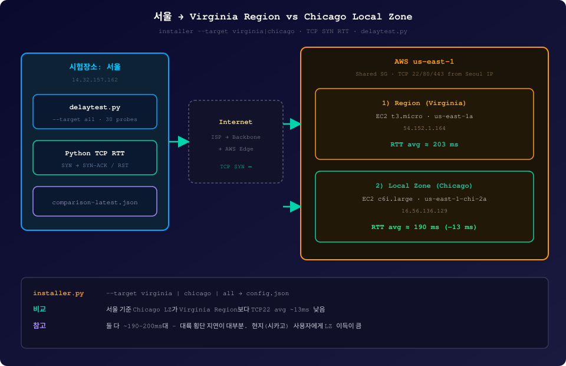
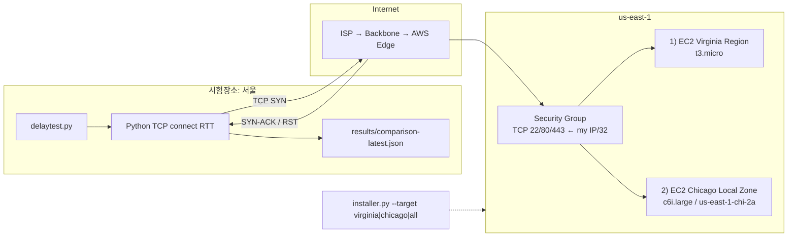
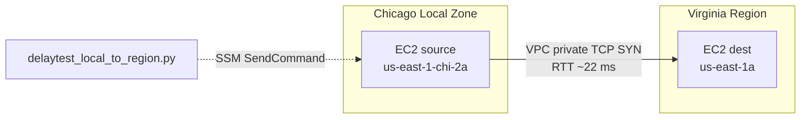

# AWS 지연(Latency) 시험 방법

PC에서 AWS까지 지연을 `tcpping`/`tcping`/Python TCP로 측정합니다.  
설치 옵션으로 **1) Virginia Region**과 **2) Chicago Local Zone**을 고를 수 있습니다.

[English README](README_en.md)

## 설치 옵션

| # | `--target` | 위치 | 종류 | 기본 인스턴스 | AZ |
|---|---|---|---|---|---|
| 1 | `virginia` | **Virginia** | Region (`us-east-1`) | `t3.micro` | `us-east-1a` 등 |
| 2 | `chicago` | **Chicago** | Local Zone | `c6i.large` | `us-east-1-chi-2a` |

```bash
python installer.py --list-targets
python installer.py --target virginia   # 1) Region (Virginia)
python installer.py --target chicago    # 2) Local Zone (Chicago)
python installer.py --target all        # 둘 다
```

## 테스트 구성도



### 구성 요약

| 구간 | 구성 | 역할 |
|---|---|---|
| 시험장소: **서울** | `delaytest.py` + Python TCP | SYN 송신, RTT 집계 |
| Internet | ISP → Backbone → AWS Edge | 실제 지연 경로 |
| 대상 1 | **EC2 Region (Virginia)** | `us-east-1` regional AZ |
| 대상 2 | **EC2 Local Zone (Chicago)** | `us-east-1-chi-2a` |



### 측정 흐름

1. **`installer.py --target …`** — SG(내 공인 IP만 허용) + 대상별 EC2 생성. Chicago는 Local Zone 서브넷을 자동 생성합니다.
2. **`delaytest.py --target all`** — 타겟별 포트에 30회 probe.
3. **RTT** — TCP **SYN → SYN-ACK/RST** (ICMP 미사용).
4. **결과** — `results/latest.json`, `latest-virginia.json`, `latest-chicago.json`, `comparison-latest.json`.

## 측정 결과 (비교)

| 항목 | 값 |
|---|---|
| 시험장소 | **서울** (공인 IP `14.32.157.162`) |
| 측정 시각 (UTC) | 2026-11-25 09:21 |
| 도구 | Python TCP connect (`--tool python`) |
| 조건 | 포트별 30회 · 간격 1초 · loss 0% |

### 서울 → 대상별 TCP 22 RTT (대표 비교)

| Target | 위치 | Kind | Host | Avg | P50 | P95 | Stdev | ~1-way |
|---|---|---|---|---:|---:|---:|---:|---:|
| **virginia** | Virginia Region | region | `54.152.1.164` | **203.4** | 199.3 | 267.7 | 19.4 | ~101.7 |
| **chicago** | Chicago Local Zone | local-zone | `16.56.136.129` | **190.1** | 191.4 | 203.7 | 9.5 | ~95.0 |

**avg 차이:** chicago − virginia = **−13.3 ms** → 서울 기준으로 Chicago Local Zone이 더 낮음.

원본: [`results/comparison-latest.json`](results/comparison-latest.json)

### 1) Virginia Region — 포트별 RTT (ms)

| Port | 상태 | Min | Avg | Max | Stdev | P95 | ~1-way |
|---|---|---:|---:|---:|---:|---:|---:|
| 22 | open | 192.4 | **203.4** | 278.6 | 19.4 | 267.7 | ~101.7 |
| 80 | open | 190.9 | **199.4** | 211.6 | 4.8 | 209.7 | ~99.7 |
| 443 | RST | 191.0 | **204.7** | 299.0 | 19.3 | 223.0 | ~102.4 |

### 2) Chicago Local Zone — 포트별 RTT (ms)

| Port | 상태 | Min | Avg | Max | Stdev | P95 | ~1-way |
|---|---|---:|---:|---:|---:|---:|---:|
| 22 | open | 175.7 | **190.1** | 208.4 | 9.5 | 203.7 | ~95.0 |
| 80 | open | 172.6 | **189.7** | 200.6 | 8.1 | 199.7 | ~94.8 |
| 443 | RST | 172.4 | **194.2** | 296.3 | 21.3 | 210.1 | ~97.1 |

### 분석

1. **서울 → 미국 중서부(Chicago LZ)가 Virginia Region보다 ~13ms 빠름**  
   TCP 22 기준 avg **190ms vs 203ms**. 태평양 횡단 이후 북미 내 홉에서 Chicago가 Virginia(동부)보다 지리적으로 가깝거나 경로가 짧은 경우가 있어, Local Zone이라도 **대륙 횡단 RTT의 대부분(~180ms+)** 은 해저/백본에서 이미 발생합니다.

2. **Local Zone ≠ 저지연 보장 (서울 기준)**  
   Chicago LZ는 시카고 **현지** 사용자에게는 Region보다 유리하지만, **서울에서는 둘 다 ~190–200ms대**입니다. Outposts/온프레미스 5ms 요건과는 스케일이 다릅니다.

3. **지터는 Chicago가 더 안정적 (이번 샘플)**  
   TCP 22 stdev: Virginia 19.4ms vs Chicago 9.5ms. Virginia 쪽 스파이크(278ms)가 avg를 끌어올렸습니다. 대표값 비교 시 **P50(199 vs 191)** 도 같은 방향입니다.

4. **포트 80 open 결과가 가장 깨끗**  
   Virginia 80 avg 199.4 / stdev 4.8, Chicago 80 avg 189.7 / stdev 8.1 — 경로 차이 ~10ms를 재확인합니다. 443(RST)은 꼬리(max~300ms)가 길어 비교용으로는 22/80을 우선하세요.

5. **실무 함의**  
   - 서울 클라이언트 → 미국 리소스: Region이든 Chicago LZ든 **왕복 ~200ms**를 각오.  
   - Chicago LZ의 이득은 **시카고/중서부 사용자 ↔ 해당 LZ** 구간에서 더 크게 나타납니다.  
   - LZ↔Region 백본 지연은 아래 [Local Zone ↔ Region](#local-zone--region-지연-측정) 실측(~22ms)을 참고하세요.

## 빠른 시작

```bash
# 옵션 확인
python installer.py --list-targets

# 1) Virginia Region + 2) Chicago Local Zone
python installer.py --target all

# 측정 (양쪽 비교)
python delaytest.py --target all --tool python

# 한쪽만
python delaytest.py --target virginia
python delaytest.py --target chicago

# 삭제
python uninstaller.py --yes                 # 전부
python uninstaller.py --target chicago -y   # Chicago만
```

## Local Zone ↔ Region 지연 측정

서울 PC가 아니라 **Chicago Local Zone EC2 → Virginia Region EC2** (동일 VPC private) 구간을 측정합니다.  
SG self-peer + SSM으로 LZ에서 Region private IP로 TCP RTT를 집계합니다.

| 파일 | 역할 |
|---|---|
| `installer_local_to_region.py` | LZ(송신) + Region(수신) EC2, SG peer, SSM IAM |
| `delaytest_local_to_region.py` | Chicago에서 SSM probe → Virginia |
| `uninstaller_local_to_region.py` | EC2 / LZ 서브넷 / SG / SSM IAM / config 삭제 |
| `config_local_to_region.json` | 전용 config (기존 `config.json`과 분리) |

```bash
# 환경 구성 (Chicago LZ + Virginia Region)
python installer_local_to_region.py

# 측정 (기본: VPC private IP)
python delaytest_local_to_region.py
python delaytest_local_to_region.py --count 30 --ports 22,80

# public IP 경로로 비교하고 싶을 때
python delaytest_local_to_region.py --via public

# 삭제
python uninstaller_local_to_region.py --yes
# 호환: python installer_local_to_region.py --destroy --yes
```



### 측정 결과 (Chicago LZ → Virginia Region)

| 항목 | 값 |
|---|---|
| 구간 | **Chicago Local Zone → Virginia Region** (VPC private) |
| 도구 | Python TCP via SSM (`python-tcp-ssm`) |
| source | `us-east-1-chi-2a` · private `172.31.106.166` |
| dest | `us-east-1a` · private `172.31.81.26` |
| 간격 | 1초 · loss 0% (두 런 모두) |

#### 단기(30회, ~1분) vs 장기(150회, ~5분)

| 런 | 시각 (UTC) | Port | n | Min | Avg | Max | Stdev | P50 | P95 | ~1-way |
|---|---|---|---:|---:|---:|---:|---:|---:|---:|---:|
| 단기 | 2026-11-26 07:46 | 22 | 30 | 19.8 | **21.8** | 23.7 | 0.8 | 22.0 | 22.3 | ~10.9 |
| 단기 | 2026-11-26 07:46 | 80 | 30 | 19.7 | **21.6** | 22.3 | 0.9 | 22.0 | 22.2 | ~10.8 |
| **장기** | **2026-11-26 07:56** | **22** | **150** | **19.7** | **21.5** | **23.5** | **1.0** | **22.0** | **22.2** | **~10.7** |
| **장기** | **2026-11-26 07:56** | **80** | **150** | **19.6** | **21.5** | **22.7** | **0.9** | **22.0** | **22.2** | **~10.8** |

**단기→장기 avg 차이 (TCP 22):** 21.8 → 21.5 (**−0.3 ms**). 5분 연속 측정에서도 분포가 거의 동일합니다.

원본: [`results/latest-local-to-region.json`](results/latest-local-to-region.json) (장기 150회), [`results/l2r-20261126T074637Z.json`](results/l2r-20261126T074637Z.json) (단기 30회)

### 구간별 한눈에 비교

| 구간 | 경로 | TCP 22 Avg | ~1-way | 비고 |
|---|---|---:|---:|---|
| 서울 → Virginia Region | Internet | **203.4** | ~101.7 | 대륙 횡단 지배 |
| 서울 → Chicago LZ | Internet | **190.1** | ~95.0 | 서울 기준 LZ가 ~13ms 유리 |
| **Chicago LZ → Virginia** | **VPC private** | **21.5** | **~10.7** | 5분(n=150) 기준 |

### 분석

1. **LZ ↔ Region은 ~21–22ms RTT (한쪽 ~11ms)**  
   VPC private에서 TCP 22/80 avg **~21.5ms**, stdev **~1ms**, loss 0%. 서울→AWS(~190–200ms)와 스케일이 완전히 다릅니다.

2. **5분 장기 측정이 단기와 일치**  
   30회(~1분)와 150회(~5분)의 avg/P50/P95가 거의 같고(avg 차이 ≤0.3ms), 스파이크·드리프트가 없습니다. 단발 샘플이 우연이 아님을 확인합니다.

3. **대륙 횡단이 전체 지연의 대부분**  
   서울→Virginia(~203ms)에서 LZ→Region(~22ms)을 빼면, 대략 **~180ms+가 서울↔북미 인터넷/백본**에 해당합니다. Local Zone을 써도 이 구간은 줄지 않습니다.

4. **지터가 매우 안정적**  
   장기 런에서도 stdev ~1ms, P50≈P95≈22ms. 인터넷 경유(서울→Virginia stdev 19ms)와 대비됩니다.

5. **실무 함의**  
   - 시카고 현지 앱 ↔ Virginia Region API/DB: **왕복 ~22ms**를 설계 예산에 넣을 수 있음.  
   - 서울(또는 원격) 클라이언트 체감 지연은 여전히 **~200ms대**가 지배적.  
   - LZ는 “현지 사용자 ↔ LZ 워크로드”와 “LZ ↔ parent Region” 분리 설계에 의미가 큼.

## 도구 설치

### 필수는 Python만

**`tcpping` / `tcping`을 꼭 설치할 필요는 없습니다.**  
`delaytest.py`는 표준 라이브러리 `socket`으로 TCP RTT를 측정하므로, **Python 3 + `boto3`** 만 있으면 됩니다.

```bash
python3 -m pip install boto3
python delaytest.py --tool python
```

| 구성 | 필요 여부 | 설명 |
|---|---|---|
| Python 3 | **필수** | RTT 측정 + 결과 집계 |
| boto3 | installer / uninstaller 필수 | EC2/SG/LZ 서브넷 |
| tcping / tcpping | **선택** | 없어도 Python이 RTT 측정 |

> macOS Homebrew `tcping` 2.x는 open/closed만 출력합니다. 이 레포는 ms를 **Python TCP connect**로 기록합니다.

### OS별 선택 설치 (원하면)

**macOS**
```bash
brew install tcping
```

**Linux (Debian/Ubuntu)**
```bash
sudo apt-get update
sudo apt-get install -y tcptraceroute perl wget
wget -O /tmp/tcpping https://raw.githubusercontent.com/Freaky/tcpping/master/tcpping
sudo install -m 755 /tmp/tcpping /usr/local/bin/tcpping
```

**Linux (RHEL / Amazon Linux)**
```bash
sudo yum install -y tcptraceroute perl wget
wget -O /tmp/tcpping https://raw.githubusercontent.com/Freaky/tcpping/master/tcpping
sudo install -m 755 /tmp/tcpping /usr/local/bin/tcpping
```

**Windows**
```powershell
# PsPing 또는 tcping-rs (선택) — 또는
python delaytest.py --tool python
```

## 측정 원리

ICMP가 아니라 **TCP SYN → SYN-ACK**(또는 **RST**) RTT입니다. SG에 TCP만 열려 있으면 됩니다.

## 삭제 (uninstaller.py)

```bash
python uninstaller.py --yes
python uninstaller.py --target virginia -y
python uninstaller.py --target chicago -y
```

삭제 대상: EC2 · LZ 서브넷 · Security Group(다른 타겟 없으면) · `config.json`

## 산출물

- `config.json` — 서울→AWS 타겟별 인스턴스/IP/SG
- `config_local_to_region.json` — LZ→Region 전용
- `results/latest.json` / `comparison-latest.json`
- `results/latest-virginia.json` / `latest-chicago.json`
- `results/latest-local-to-region.json` / `l2r-*.json`
- `docs/architecture.svg`
