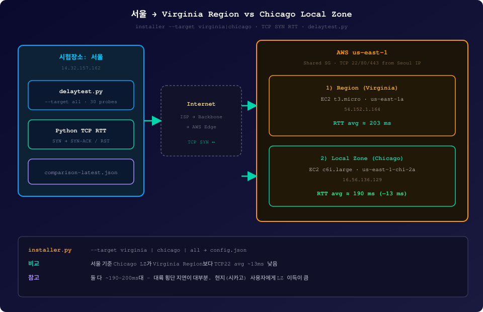
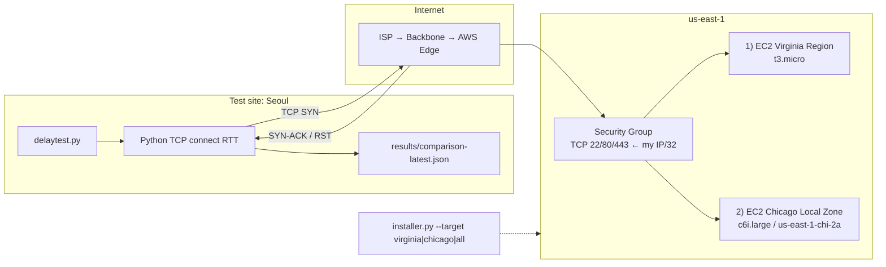
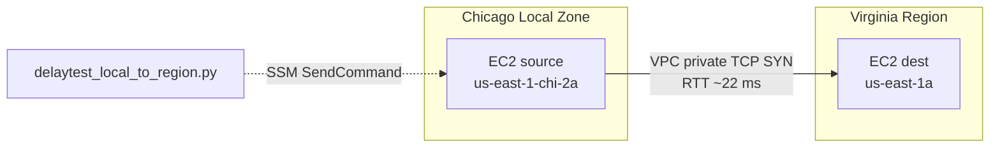

# Measuring AWS Latency

Measure latency from a PC to AWS using `tcpping` / `tcping` / Python TCP.  
Install targets: **1) Virginia Region** and **2) Chicago Local Zone**.

[한국어 README](README.md)

## Install targets

| # | `--target` | Location | Type | Default instance | AZ |
|---|---|---|---|---|---|
| 1 | `virginia` | **Virginia** | Region (`us-east-1`) | `t3.micro` | `us-east-1a`, etc. |
| 2 | `chicago` | **Chicago** | Local Zone | `c6i.large` | `us-east-1-chi-2a` |

```bash
python installer.py --list-targets
python installer.py --target virginia   # 1) Region (Virginia)
python installer.py --target chicago    # 2) Local Zone (Chicago)
python installer.py --target all        # both
```

## Test architecture



### Components

| Segment | Setup | Role |
|---|---|---|
| Test site: **Seoul** | `delaytest.py` + Python TCP | Send SYN, aggregate RTT |
| Internet | ISP → Backbone → AWS Edge | Actual latency path |
| Target 1 | **EC2 Region (Virginia)** | `us-east-1` regional AZ |
| Target 2 | **EC2 Local Zone (Chicago)** | `us-east-1-chi-2a` |



### Measurement flow

1. **`installer.py --target …`** — Create a security group (allow only your public IP) and per-target EC2. For Chicago, a Local Zone subnet is created automatically.
2. **`delaytest.py --target all`** — 30 probes per port per target.
3. **RTT** — TCP **SYN → SYN-ACK/RST** (no ICMP).
4. **Outputs** — `results/latest.json`, `latest-virginia.json`, `latest-chicago.json`, `comparison-latest.json`.

## Results (comparison)

| Field | Value |
|---|---|
| Test site | **Seoul** (public IP `14.32.157.162`) |
| Measured at (UTC) | 2026-11-25 09:21 |
| Tool | Python TCP connect (`--tool python`) |
| Conditions | 30 probes per port · 1s interval · 0% loss |

### Seoul → TCP 22 RTT by target (headline)

| Target | Location | Kind | Host | Avg | P50 | P95 | Stdev | ~1-way |
|---|---|---|---|---:|---:|---:|---:|---:|
| **virginia** | Virginia Region | region | `54.152.1.164` | **203.4** | 199.3 | 267.7 | 19.4 | ~101.7 |
| **chicago** | Chicago Local Zone | local-zone | `16.56.136.129` | **190.1** | 191.4 | 203.7 | 9.5 | ~95.0 |

**avg delta:** chicago − virginia = **−13.3 ms** → from Seoul, Chicago Local Zone is lower.

Source: [`results/comparison-latest.json`](results/comparison-latest.json)

### 1) Virginia Region — RTT by port (ms)

| Port | State | Min | Avg | Max | Stdev | P95 | ~1-way |
|---|---|---:|---:|---:|---:|---:|---:|
| 22 | open | 192.4 | **203.4** | 278.6 | 19.4 | 267.7 | ~101.7 |
| 80 | open | 190.9 | **199.4** | 211.6 | 4.8 | 209.7 | ~99.7 |
| 443 | RST | 191.0 | **204.7** | 299.0 | 19.3 | 223.0 | ~102.4 |

### 2) Chicago Local Zone — RTT by port (ms)

| Port | State | Min | Avg | Max | Stdev | P95 | ~1-way |
|---|---|---:|---:|---:|---:|---:|---:|
| 22 | open | 175.7 | **190.1** | 208.4 | 9.5 | 203.7 | ~95.0 |
| 80 | open | 172.6 | **189.7** | 200.6 | 8.1 | 199.7 | ~94.8 |
| 443 | RST | 172.4 | **194.2** | 296.3 | 21.3 | 210.1 | ~97.1 |

### Analysis

1. **Seoul → U.S. Midwest (Chicago LZ) is ~13 ms faster than Virginia Region**  
   TCP 22 avg **190 ms vs 203 ms**. After the trans-Pacific path, Chicago can sit on a shorter North American hop than Virginia (East Coast). Even so, most of the continental RTT (**~180 ms+**) is already spent on submarine/backbone segments—Local Zone does not remove that.

2. **Local Zone ≠ low latency from Seoul**  
   Chicago LZ helps **local** Chicago users versus a distant Region AZ, but from **Seoul both land in the ~190–200 ms band**. That is a different scale from Outposts / on-premises ~5 ms requirements.

3. **Jitter was better on Chicago in this sample**  
   TCP 22 stdev: Virginia 19.4 ms vs Chicago 9.5 ms. A Virginia spike (278 ms) pulled the average up. **P50 (199 vs 191)** points the same way.

4. **Port 80 (open) is the cleanest signal**  
   Virginia 80 avg 199.4 / stdev 4.8; Chicago 80 avg 189.7 / stdev 8.1 — about ~10 ms path difference. Port 443 (RST) has a long tail (max ~300 ms); prefer 22/80 for comparisons.

5. **Practical takeaways**  
   - Seoul client → U.S. resources: expect **~200 ms RTT** whether Region or Chicago LZ.  
   - Chicago LZ gains show up more clearly for **Chicago / Midwest users ↔ that Local Zone**.  
   - For LZ↔Region backbone latency, see [Local Zone ↔ Region](#local-zone--region-latency) (~22 ms measured).

## Quick start

```bash
# List options
python installer.py --list-targets

# 1) Virginia Region + 2) Chicago Local Zone
python installer.py --target all

# Measure (compare both)
python delaytest.py --target all --tool python

# Single target
python delaytest.py --target virginia
python delaytest.py --target chicago

# Tear down
python uninstaller.py --yes                 # all
python uninstaller.py --target chicago -y   # Chicago only
```

## Local Zone ↔ Region latency

Measure **Chicago Local Zone EC2 → Virginia Region EC2** on the same VPC private path (not Seoul PC → AWS). SG self-peer + SSM runs the TCP probe from the LZ instance.

```bash
python installer_local_to_region.py
python delaytest_local_to_region.py
python delaytest_local_to_region.py --via public   # optional public path
python uninstaller_local_to_region.py --yes
# compat: python installer_local_to_region.py --destroy --yes
```



### Results (Chicago LZ → Virginia Region)

| Field | Value |
|---|---|
| Path | **Chicago Local Zone → Virginia Region** (VPC private) |
| Tool | Python TCP via SSM (`python-tcp-ssm`) |
| source | `us-east-1-chi-2a` · private `172.31.106.166` |
| dest | `us-east-1a` · private `172.31.81.26` |
| Interval | 1s · 0% loss (both runs) |

#### Short (30 probes, ~1 min) vs long (150 probes, ~5 min)

| Run | Time (UTC) | Port | n | Min | Avg | Max | Stdev | P50 | P95 | ~1-way |
|---|---|---|---:|---:|---:|---:|---:|---:|---:|---:|
| Short | 2026-11-26 07:46 | 22 | 30 | 19.8 | **21.8** | 23.7 | 0.8 | 22.0 | 22.3 | ~10.9 |
| Short | 2026-11-26 07:46 | 80 | 30 | 19.7 | **21.6** | 22.3 | 0.9 | 22.0 | 22.2 | ~10.8 |
| **Long** | **2026-11-26 07:56** | **22** | **150** | **19.7** | **21.5** | **23.5** | **1.0** | **22.0** | **22.2** | **~10.7** |
| **Long** | **2026-11-26 07:56** | **80** | **150** | **19.6** | **21.5** | **22.7** | **0.9** | **22.0** | **22.2** | **~10.8** |

**Short→long avg delta (TCP 22):** 21.8 → 21.5 (**−0.3 ms**). Distribution stays the same over a 5-minute window.

Source: [`results/latest-local-to-region.json`](results/latest-local-to-region.json) (long n=150), [`results/l2r-20261126T074637Z.json`](results/l2r-20261126T074637Z.json) (short n=30)

### Cross-path comparison

| Path | Route | TCP 22 Avg | ~1-way | Notes |
|---|---|---:|---:|---|
| Seoul → Virginia Region | Internet | **203.4** | ~101.7 | Transcontinental dominated |
| Seoul → Chicago LZ | Internet | **190.1** | ~95.0 | ~13 ms better from Seoul |
| **Chicago LZ → Virginia** | **VPC private** | **21.5** | **~10.7** | 5 min (n=150) |

### Analysis

1. **LZ ↔ Region ≈ 21–22 ms RTT (~11 ms one-way)**  
   On VPC private, TCP 22/80 avg **~21.5 ms**, stdev **~1 ms**, 0% loss—orders of magnitude below Seoul→AWS (~190–200 ms).

2. **5-minute run matches the short sample**  
   30 probes (~1 min) and 150 probes (~5 min) have nearly identical avg/P50/P95 (avg delta ≤0.3 ms); no spike or drift. The short sample was not a fluke.

3. **Most Seoul→AWS latency is the long haul**  
   Seoul→Virginia (~203 ms) minus LZ→Region (~22 ms) leaves roughly **~180 ms+** on Seoul↔North America internet/backbone. Local Zone does not remove that.

4. **Very stable jitter**  
   Even in the long run, stdev ~1 ms; P50≈P95≈22 ms—unlike Seoul→Virginia (stdev 19 ms).

5. **Practical takeaways**  
   - Chicago-local app ↔ Virginia Region API/DB: budget **~22 ms RTT**.  
   - Remote (e.g. Seoul) client latency remains **~200 ms**-class.  
   - LZ shines when you separate “local users ↔ LZ workload” from “LZ ↔ parent Region”.

Config: `config_local_to_region.json` (separate from `config.json`)  
Outputs: `results/latest-local-to-region.json`, `results/l2r-*.json`

## Tooling

### Python alone is enough

**You do not need to install `tcpping` / `tcping`.**  
`delaytest.py` measures TCP RTT with the standard-library `socket` module—**Python 3 + `boto3`** is sufficient.

```bash
python3 -m pip install boto3
python delaytest.py --tool python
```

| Component | Required? | Notes |
|---|---|---|
| Python 3 | **Required** | RTT measurement + stats |
| boto3 | Required for installer / uninstaller | EC2 / SG / LZ subnet |
| tcping / tcpping | **Optional** | Python still measures RTT without them |

> macOS Homebrew `tcping` 2.x only prints open/closed. This repo records milliseconds via **Python TCP connect**.

### Optional OS installs

**macOS**
```bash
brew install tcping
```

**Linux (Debian/Ubuntu)**
```bash
sudo apt-get update
sudo apt-get install -y tcptraceroute perl wget
wget -O /tmp/tcpping https://raw.githubusercontent.com/Freaky/tcpping/master/tcpping
sudo install -m 755 /tmp/tcpping /usr/local/bin/tcpping
```

**Linux (RHEL / Amazon Linux)**
```bash
sudo yum install -y tcptraceroute perl wget
wget -O /tmp/tcpping https://raw.githubusercontent.com/Freaky/tcpping/master/tcpping
sudo install -m 755 /tmp/tcpping /usr/local/bin/tcpping
```

**Windows**
```powershell
# Optional: PsPing or tcping-rs — or
python delaytest.py --tool python
```

## How measurement works

RTT is **TCP SYN → SYN-ACK** (or **RST**), not ICMP. Only the TCP ports need to be open in the security group.

## Uninstall (`uninstaller.py`)

```bash
python uninstaller.py --yes
python uninstaller.py --target virginia -y
python uninstaller.py --target chicago -y
```

Deletes: EC2 · LZ subnet · security group (if no other target remains) · `config.json`

## Artifacts

- `config.json` — Seoul→AWS per-target instance / IP / SG
- `config_local_to_region.json` — LZ→Region dedicated config
- `results/latest.json` / `comparison-latest.json`
- `results/latest-virginia.json` / `latest-chicago.json`
- `results/latest-local-to-region.json` / `l2r-*.json`
- `docs/architecture.svg`
